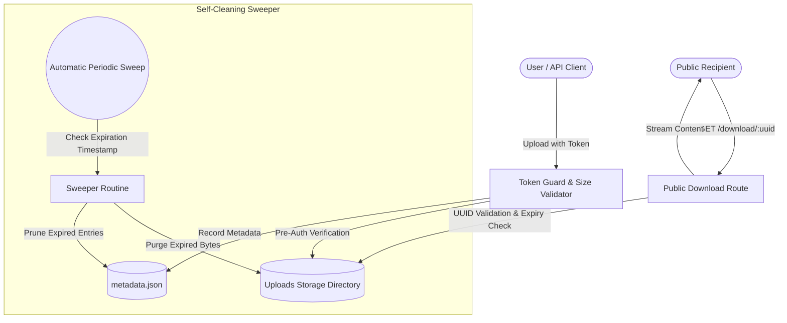

<p align="center"><a href="https://kitsunetechnologies.org/work"></a></p>

# Drop Harbor

> Zero-database, self-hosted temporary file drop service. Upload files, generate expiring download links, search your collection, and let files automatically clean up.

<p align="center">
  <a href="https://github.com/KitsuneTech1/drop-harbor/releases"></a>
  <a href="https://github.com/KitsuneTech1/drop-harbor/actions/workflows/ci.yml"></a>
  <a href="LICENSE"></a>
  <a href="https://nodejs.org"></a>
  <a href="Dockerfile"></a>
  <a href="server.js"></a>
</p>

<p align="center">
  <a href="https://github.com/KitsuneTech1/drop-harbor/releases/latest"><strong>📦 Download Latest Release ZIP</strong></a> •
  <a href="#-quick-start-for-beginners-zero-config"><strong>⚡ Quick Start Guide</strong></a> •
  <a href="#-docker--production-deployment"><strong>🐳 Docker Guide</strong></a>
</p>

---

## Architecture & Lifecycle



---

## Features

- **Zero Database Required**: Operates using simple, atomic flat-file metadata storage on disk. No SQL, Redis, or Mongo needed.
- **Auto-Expiring Files**: Choose retention periods from 1 hour to 30 days. Files and metadata are swept off disk automatically.
- **Secure Upload Guard**: Uploads and deletions are protected by a shared token (`UPLOAD_TOKEN`) checked before any bytes reach the disk.
- **Instant Search**: Search through stored files in real time directly from the web interface.
- **Public UUID Links**: Share download URLs with non-authenticated users without exposing server file names or storage paths.
- **Docker Ready**: Includes lightweight, multi-stage Alpine Dockerfile.

---

## 🚀 Quick Start for Beginners (Zero Config)

### Option 1: One-Click Launch (Windows / Mac / Linux)
1. Download the [**Latest Release ZIP**](https://github.com/KitsuneTech1/drop-harbor/releases/latest) and unzip it.
2. Double-click **`start.bat`** (Windows) or run `./start.sh` (macOS/Linux).
3. The launcher configures your local environment, installs dependencies, and opens `http://localhost:3000` in your browser.

---

## 🐳 Docker & Production Deployment

### Run with Docker

```bash
# Build the container
docker build -t drop-harbor .

# Run the container with persistent storage
docker run -d \
  -p 3000:3000 \
  -v drop-data:/app/uploads \
  -e UPLOAD_TOKEN="your-secure-secret-token" \
  --name drop-harbor \
  drop-harbor
```

### Self-Hosting with Node.js

```bash
git clone https://github.com/KitsuneTech1/drop-harbor.git
cd drop-harbor
npm install

# Copy environment template
cp .env.example .env

# Generate a secure token
node -e "console.log(require('crypto').randomBytes(24).toString('hex'))"
# Paste this token into your .env file as UPLOAD_TOKEN

npm start
```

---

## 📡 HTTP API Reference

### Upload a File
```bash
curl -X POST http://localhost:3000/upload \
  -H "X-Upload-Token: your-secure-secret-token" \
  -F "file=@example.pdf" \
  -F "expiry=7d"
```

Response:
```json
{
  "id": "174932ed-9d55-4f65-84ae-439324e55571",
  "filename": "example.pdf",
  "size": 1048576,
  "downloadUrl": "/download/174932ed-9d55-4f65-84ae-439324e55571",
  "expiresAt": 1793548800000
}
```

### Download a File (Public)
```bash
curl -O -J http://localhost:3000/download/174932ed-9d55-4f65-84ae-439324e55571
```

### Delete a File
```bash
curl -X DELETE http://localhost:3000/files/174932ed-9d55-4f65-84ae-439324e55571 \
  -H "X-Upload-Token: your-secure-secret-token"
```

---

## 🧪 Testing

Run the automated offline test suite:

```bash
npm test
```

Tests cover:
- Pre-upload token verification (ensures unauthenticated streams never touch disk).
- Round-trip upload, streaming download, and expiration deletion.
- Path traversal injection defenses.
- Orphan file detection and automatic cleanup sweeps.

---

## 🔒 Security Model

- **Disk-Fill Prevention**: Token checks occur in memory before file streams are buffered to disk.
- **UUID Sanitization**: Downloads only resolve via UUID v4 tokens; filesystem paths are never accepted from clients.
- **Fail-Safe Startup**: Rejects startup if configured with blank or default tokens unless explicitly allowed via `ALLOW_UNAUTHENTICATED_UPLOADS=true`.

---

## License

MIT. Copyright (c) 2026 Kitsune Technologies LLC. Full text in [LICENSE](LICENSE).

<p align="center"><sub>Part of <b>Buildtober 2026</b>: 31 open source projects in 31 days. Built by <a href="https://kitsunetechnologies.org/work">Kitsune Technologies</a>. More at <a href="https://github.com/KitsuneTech1">github.com/KitsuneTech1</a>.</sub></p>
